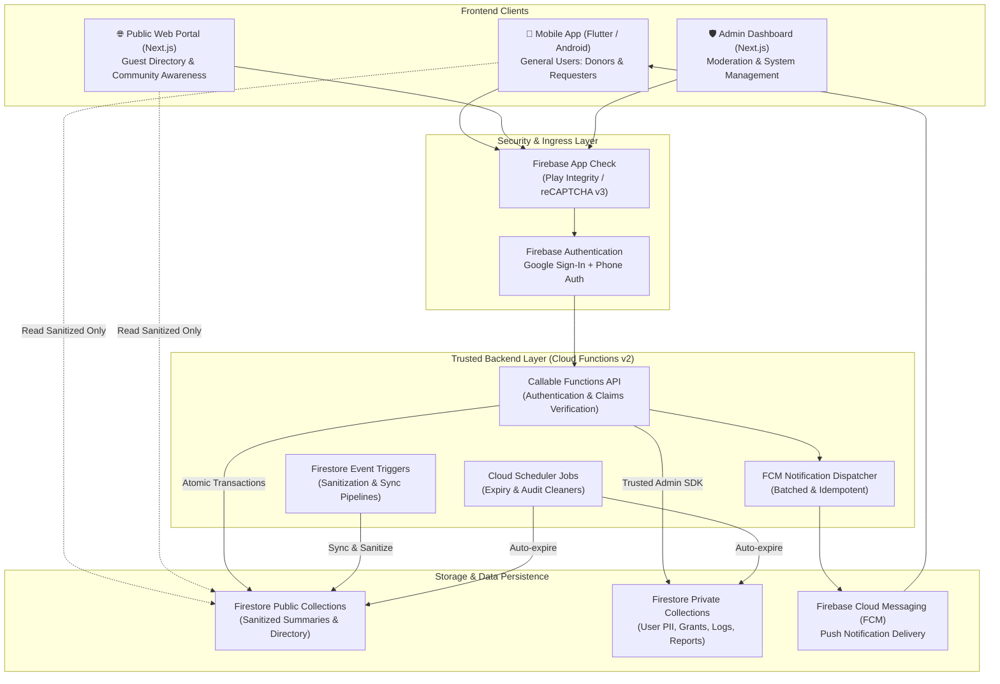
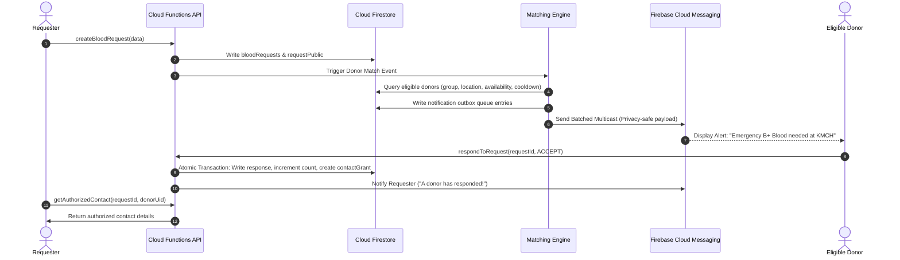

# System Architecture Document
## Badhon (NWU Blood Connect)
**Platform Name:** Badhon (বাঁধন) — NWU Blood Connect  
**Document Version:** 1.0.0  
**Phase:** Phase 1 — Requirements and Architecture  
**Date:** October 2026  

---

## 1. System Overview & Architectural Diagram

Badhon is designed as a secure, distributed multi-client system utilizing Google Cloud Platform (GCP) and Firebase infrastructure. The system comprises three distinct frontends, a unified TypeScript backend on Cloud Functions, and Google Cloud Firestore.



---

## 2. Monorepo Repository Structure

The project employs a structured monorepo layout that cleanly isolates the Flutter mobile application, the Next.js web portals, shared TypeScript packages, and Firebase backend code:

```
Badhon/
├── apps/
│   ├── mobile/                  # Android mobile application (Flutter / Dart)
│   │   ├── lib/
│   │   │   ├── core/            # Theme, constants, networking, error handling
│   │   │   ├── features/        # Feature-driven slices (auth, donor, request, contact)
│   │   │   └── main.dart        # Flutter entrypoint
│   │   ├── test/                # Unit and widget tests
│   │   └── pubspec.yaml         # Dart dependencies
│   ├── web/                     # Public web portal (Next.js 15, TypeScript, Tailwind CSS)
│   │   ├── src/
│   │   │   ├── app/             # Next.js App Router pages
│   │   │   ├── components/      # UI components (shadcn/ui inspired primitives)
│   │   │   └── lib/             # Firebase client SDK initialization
│   │   ├── package.json
│   │   └── tailwind.config.ts
│   └── admin/                   # Protected admin dashboard (Next.js 15, TypeScript, Tailwind)
│       ├── src/
│       │   ├── app/             # Protected admin routes (/overview, /moderation, /audit)
│       │   ├── components/      # Data tables, filters, moderation modals
│       │   └── lib/             # Admin auth context & custom claims validation
│       ├── package.json
│       └── tailwind.config.ts
├── functions/                   # Backend Cloud Functions (TypeScript, Node.js 20)
│   ├── src/
│   │   ├── auth/                # Auth triggers & custom claims management
│   │   ├── requests/            # Request lifecycle, validation & state transitions
│   │   ├── responses/           # Response recording & atomic contact grants
│   │   ├── notifications/       # Matching engine & FCM batch dispatchers
│   │   ├── admin/               # Privileged admin endpoints
│   │   └── scheduled/           # Expiry cleaner cron jobs
│   ├── test/                    # Integration & unit tests for functions
│   ├── package.json
│   └── tsconfig.json
├── packages/
│   ├── domain/                  # Shared domain types, enums, and validators (TypeScript)
│   │   ├── src/
│   │   │   ├── enums.ts         # BloodGroup, RequestStatus, Urgency, Affiliation
│   │   │   ├── models.ts        # UserProfile, BloodRequest, ContactGrant interfaces
│   │   │   └── index.ts
│   │   └── package.json
│   └── api-contracts/           # Zod schemas for callable API validation
│       ├── src/
│       │   ├── requestSchemas.ts
│       │   ├── responseSchemas.ts
│       │   └── index.ts
│       └── package.json
├── firebase/                    # Firebase configuration and security rules
│   ├── firestore.rules          # Strict default-deny Firestore security rules
│   ├── firestore.indexes.json   # Composite query indexes
│   ├── firestore.rules.test.ts  # Rules tests with Firebase Emulator Suite
│   └── storage.rules            # Storage rules (locked by default)
├── docs/                        # Complete Phase 1 architecture documentation
├── .env.example                 # Environment variable templates
├── firebase.json                # Firebase configuration & emulators config
├── package.json                 # Monorepo root workspace configuration (pnpm / npm)
└── README.md
```

---

## 3. Trust Boundaries & Security Architecture

### 3.1 The Dual-Document Pattern (Public vs. Private)
Firestore security rules operate on the document level; they cannot filter out specific fields from a document during a query. To guarantee zero private data leakage:

1. **Donors:**
   - `users/{uid}`: Master identity document (owned by user, private).
   - `donorPrivate/{uid}`: Verified phone, private notes, notification tokens (private).
   - `donorPublic/{uid}`: Sanitized public card (display name, blood group, upazila, availability, affiliation badge). Readable by guests and clients; strictly excludes phone and email.
2. **Blood Requests:**
   - `bloodRequests/{requestId}`: Master request document (owned by requester, contains full contact metadata and requester ID).
   - `requestPublic/{requestId}`: Sanitized summary (blood group, units, hospital name, district/upazila, urgency, required time). Publicly indexable.

### 3.2 Server-Mediated Contact Sharing
Contact sharing is strictly mediated by trusted backend logic:
- The requester cannot read the donor's phone number directly from Firestore.
- When a donor accepts, the server creates an atomic `contactGrants` document.
- The requester accesses the contact number via the `getAuthorizedContact(requestId, donorUid)` Cloud Function.
- The Cloud Function executes server-side checks:
  1. Authenticates caller ID token.
  2. Verifies the caller is the exact requester for `requestId`.
  3. Verifies the donor actually accepted `requestId`.
  4. Verifies the request is not `CANCELLED`, `EXPIRED`, or `FULFILLED`.
  5. Verifies the grant is active and not revoked.
  6. Emits an audit log and returns the minimal contact payload.

---

## 4. Concurrency & Idempotency Design

### 4.1 Deterministic Document Keys
To prevent duplicate records from rapid taps, network replays, or race conditions:
- **Donor Responses:** Document ID is set deterministically:  
  `responseId = "resp_" + requestId + "_" + donorUid`
- **Contact Grants:** Document ID is set deterministically:  
  `grantId = "grant_" + requestId + "_" + donorUid`
- **Idempotency Keys:** Mutating API calls accept an optional `idempotencyKey` stored in `idempotencyKeys/{key}` with a 24-hour TTL.

### 4.2 Concurrency-Safe State Transitions
When a donor accepts a request:
1. A Firestore transaction reads `bloodRequests/{requestId}` and `requestResponses/{responseId}`.
2. The transaction asserts that `bloodRequests/{requestId}.status` is `OPEN` or `IN_PROGRESS`.
3. The transaction asserts that `responseId` does not already exist.
4. The transaction writes the response record, increments `acceptedCount`, creates `contactGrants/{grantId}`, and updates status to `IN_PROGRESS`.
5. If another donor accepts concurrently, Firestore's optimistic locking retries the transaction cleanly.

---

## 5. Background Processing & Notification Pipeline



### 5.1 Push Notification Privacy Rule
> [!CAUTION]
> **Push notifications are transmitted across untrusted mobile networks and third-party push notification services.**  
> - FCM payloads must **NEVER** contain donor or requester phone numbers, patient names, specific bed numbers, or private medical details.
> - Payloads contain only: `requestId`, `bloodGroup`, `hospitalName`, `district`, `urgency`, and deep-link URI. The app fetches authorized details from the backend over authenticated TLS.

---

## 6. Technology Stack & Version Matrix

| Layer | Technology | Version | Purpose |
| :--- | :--- | :--- | :--- |
| **Mobile App** | Flutter / Dart | Flutter 3.24+ / Dart 3.5+ | Native Android application with Material 3 |
| **Web Portal** | Next.js / React | Next.js 15+ / React 19+ | SEO-friendly public portal & landing page |
| **Admin Portal** | Next.js / React | Next.js 15+ / React 19+ | Protected admin dashboard |
| **Styling** | Tailwind CSS | v3.4+ / v4.0 | Responsive utility styling with shared design tokens |
| **Backend** | Cloud Functions v2 | Node.js 20 / TypeScript 5.5+ | Serverless trusted backend API |
| **Database** | Cloud Firestore | Native Mode | Multi-region NoSQL transactional database |
| **Authentication**| Firebase Auth | v11+ SDK | Google Sign-In, Phone Auth linking, Custom Claims |
| **Messaging** | FCM v1 HTTP API | Current | Cross-platform push notifications |
| **Testing** | Firebase Emulator Suite | CLI 13.x+ | Local offline Firestore rules & functions testing |
| **Validation** | Zod | 3.23+ | Shared schema validation across contracts |
