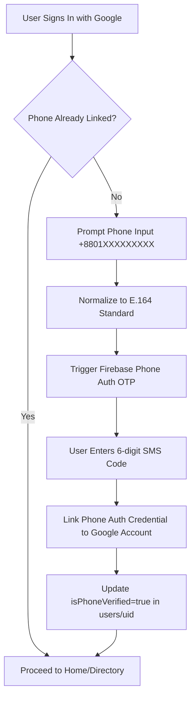

# Security Model & Threat Assessment
## Badhon (NWU Blood Connect)
**Platform Name:** Badhon (বাঁধন) — NWU Blood Connect  
**Document Version:** 1.0.0  
**Phase:** Phase 1 — Requirements and Architecture  
**Date:** October 2026  

---

## 1. Security Architecture & Threat Matrix

Badhon handles sensitive personal contact numbers and emergency coordination in high-stress medical scenarios. The security architecture is built on a **defense-in-depth**, **least-privilege**, and **privacy-by-design** posture.

### 1.1 Comprehensive Threat Model

| # | Threat Vector | Attack Scenario | Architectural Defense & Mitigation |
| :- | :--- | :--- | :--- |
| **T1** | **Unauthorized Contact Harvesting** | Malicious crawler queries database to harvest donor phone numbers for telemarketing or harassment. | **Dual-Document Partitioning & Server Gating:** `donorPublic` does not contain phone numbers. Direct Firestore reads on `donorPrivate` and `contactGrants` are denied. Contact info is accessible *only* via `getAuthorizedContact` after explicit donor acceptance. |
| **T2** | **Fake Blood Requests & Spam** | Spammer creates dozens of non-existent emergency requests to cause panic or exhaust donor goodwill. | **Rate Limiting & Server Validation:** Limits active requests to max 3 per user. Phone verification mandatory before request creation. Admin moderation queue and community reporting. |
| **T3** | **Client-Side Role Spoofing** | Attacker modifies local Firestore profile document to set `role: "ADMIN"` or `isAdmin: true`. | **Decoupled Custom Claims:** Firestore rules and Cloud Functions ignore all client-provided role fields. Privileged routes require cryptographically signed Firebase Auth Custom Claims (`admin: true`) managed via Admin SDK. |
| **T4** | **Replay & Duplicate Operations** | Flaky network or malicious user repeatedly submits accept actions, creating duplicate grants. | **Deterministic Keys & Idempotency Store:** Deterministic document ID `resp_${requestId}_${donorUid}` guarantees that subsequent writes fail or collide idempotently without incrementing counters. |
| **T5** | **Push Notification Payload Leakage** | Patient phone numbers or sensitive medical diagnoses intercepted via lockscreen or notification logs. | **Zero-PII Push Policy:** Notification payloads contain only non-sensitive tokens (`requestId`, `bloodGroup`, `hospitalName`). Personal phone numbers are never included in FCM payloads. |
| **T6** | **User Enumeration & Scraping** | Script loops through potential UIDs to download user identities. | **Public Collection Sanitization:** Public directory queries only surface donors who have opted into `isPublicVisible: true`. Public documents contain no emails, IDs, or phone numbers. |
| **T7** | **Concurrent Donor Accepts** | Two donors click "Accept" simultaneously for a request needing only 1 donor. | **Firestore Concurrency Transactions:** Atomic transactions check `acceptedCount < donorsNeeded` before writing the response and grant, gracefully notifying subsequent donors when the quota is reached. |
| **T8** | **Leaked Device Tokens** | Third party obtains FCM token and attempts to impersonate or inject spoofed messages. | **Token-to-UID Association:** Device tokens are stored under `deviceTokens/{uid}/tokens/{tokenId}` with owner-only access. Server only delivers notifications initiated by verified system triggers. |
| **T9** | **Compromised Admin Accounts** | An admin account credential is leaked. | **Least-Privilege & Auditability:** Privileged actions are logged to immutable `adminAuditLogs`. Super Admin privileges require MFA and can revoke compromised admin claims immediately. |
| **T10**| **Abuse of Cloud Functions** | Script spams expensive Callable functions to cause denial of wallet or denial of service. | **App Check & Callable Rate Limiting:** Enforce Firebase App Check (Play Integrity on Android, reCAPTCHA Enterprise on Web) and memory/rate quotas per authenticated UID. |
| **T11**| **Sensitive Data Exposure in Server Logs** | Cloud Functions log raw request payloads containing unencrypted donor phone numbers. | **Strict Log Sanitization:** Logging middleware masks all phone numbers (`+8801*****123`) and scrubs auth tokens from Google Cloud Logging. |
| **T12**| **Orphaned Access Post-Cancellation** | Requester accesses donor contact after cancelling or fulfilling the request. | **Grant Revocation Hook:** Request status transitions (`CANCELLED`, `FULFILLED`, `EXPIRED`) immediately mark associated `contactGrants` as `REVOKED`. The `getAuthorizedContact` endpoint strictly rejects revoked grants. |

---

## 2. Firestore Security Rules Specification

Firestore security rules enforce a **strict default-deny baseline**. Rules are organized with shared validator functions and explicit match blocks:

```javascript
rules_version = '2';
service cloud.firestore {
  match /databases/{database}/documents {

    // ========================================================
    // HELPER FUNCTIONS & AUTHENTICATION PREDICATES
    // ========================================================

    function isAuthenticated() {
      return request.auth != null;
    }

    function isOwner(uid) {
      return isAuthenticated() && request.auth.uid == uid;
    }

    function isAdmin() {
      return isAuthenticated() && 
             request.auth.token.admin == true;
    }

    function isSuperAdmin() {
      return isAuthenticated() && 
             request.auth.token.superAdmin == true;
    }

    function isValidBloodGroup(bg) {
      return bg in [
        'A_POSITIVE', 'A_NEGATIVE', 
        'B_POSITIVE', 'B_NEGATIVE', 
        'AB_POSITIVE', 'AB_NEGATIVE', 
        'O_POSITIVE', 'O_NEGATIVE'
      ];
    }

    // Default Deny Everything
    match /{document=**} {
      allow read, write: if false;
    }

    // ========================================================
    // USERS COLLECTION: users/{uid}
    // ========================================================
    match /users/{uid} {
      allow read: if isOwner(uid) || isAdmin();
      
      // User can create their initial profile document
      allow create: if isOwner(uid) 
                    && request.resource.data.uid == uid
                    && request.resource.data.email == request.auth.token.email
                    && request.resource.data.accountStatus == 'ACTIVE'
                    && request.resource.data.affiliationVerified == false;

      // User can update limited personal fields; cannot self-grant verification or status
      allow update: if isOwner(uid) 
                    && request.resource.data.uid == uid
                    && request.resource.data.email == resource.data.email
                    && request.resource.data.affiliationVerified == resource.data.affiliationVerified
                    && request.resource.data.accountStatus == resource.data.accountStatus;
      
      allow delete: if false; // Deletion handled via trusted Cloud Function
    }

    // ========================================================
    // DONOR PRIVATE: donorPrivate/{uid}
    // ========================================================
    match /donorPrivate/{uid} {
      allow read, write: if isOwner(uid);
    }

    // ========================================================
    // DONOR PUBLIC: donorPublic/{uid}
    // ========================================================
    match /donorPublic/{uid} {
      // Anyone can read sanitized public donor documents that opted into visibility
      allow read: if resource.data.isPublicVisible == true;
      allow write: if false; // Writes exclusively performed by Cloud Functions Admin SDK
    }

    // ========================================================
    // REQUESTER PRIVATE: requesterPrivate/{uid}
    // ========================================================
    match /requesterPrivate/{uid} {
      allow read, write: if isOwner(uid);
    }

    // ========================================================
    // BLOOD REQUESTS: bloodRequests/{requestId}
    // ========================================================
    match /bloodRequests/{requestId} {
      // Requester owner, admins, or callers with valid grants can read
      allow read: if isAuthenticated() && (
        resource.data.requesterUid == request.auth.uid ||
        isAdmin()
      );
      
      // Client direct writes denied; requests must be created/updated via Cloud Functions
      allow write: if false; 
    }

    // ========================================================
    // REQUEST PUBLIC: requestPublic/{requestId}
    // ========================================================
    match /requestPublic/{requestId} {
      // Publicly viewable by all guests and users
      allow read: if true;
      allow write: if false; // Maintained solely by Cloud Functions
    }

    // ========================================================
    // REQUEST RESPONSES: requestResponses/{responseId}
    // ========================================================
    match /requestResponses/{responseId} {
      allow read: if isAuthenticated() && (
        resource.data.requesterUid == request.auth.uid ||
        resource.data.donorUid == request.auth.uid ||
        isAdmin()
      );
      allow write: if false; // Written via transactional Cloud Function
    }

    // ========================================================
    // CONTACT GRANTS: contactGrants/{grantId}
    // ========================================================
    match /contactGrants/{grantId} {
      // Strict lockdown: client cannot directly query grants; access is via Cloud Function
      allow read, write: if false;
    }

    // ========================================================
    // NOTIFICATIONS: notifications/{notificationId}
    // ========================================================
    match /notifications/{notificationId} {
      allow read: if isAuthenticated() && resource.data.userId == request.auth.uid;
      // Recipient can only mark read: isRead == true
      allow update: if isAuthenticated() && resource.data.userId == request.auth.uid
                    && request.resource.data.diff(resource.data).affectedKeys().hasOnly(['isRead']);
      allow create, delete: if false;
    }

    // ========================================================
    // DEVICE TOKENS: deviceTokens/{uid}/tokens/{tokenId}
    // ========================================================
    match /deviceTokens/{uid}/tokens/{tokenId} {
      allow read, write: if isOwner(uid);
    }

    // ========================================================
    // REPORTS: reports/{reportId}
    // ========================================================
    match /reports/{reportId} {
      allow read: if isAuthenticated() && (
        resource.data.reporterUid == request.auth.uid ||
        isAdmin()
      );
      allow write: if false; // Submissions mediated via Cloud Function
    }

    // ========================================================
    // ADMIN AUDIT LOGS: adminAuditLogs/{logId}
    // ========================================================
    match /adminAuditLogs/{logId} {
      allow read: if isSuperAdmin();
      allow write: if false;
    }

    // ========================================================
    // SYSTEM CONFIG: systemConfig/{configId}
    // ========================================================
    match /systemConfig/{configId} {
      allow read: if isAuthenticated();
      allow write: if false;
    }
  }
}
```

---

## 3. Custom Claims & Privileged Authorization

### 3.1 Role Token Injection
Administrative privileges are baked directly into the Firebase Authentication ID token via Custom Claims:
- `admin: true`: Allows reading moderation queues, suspending users, cancelling fraudulent requests.
- `superAdmin: true`: Allows assigning admin claims, editing system configuration, and reading raw audit logs.

### 3.2 Bootstrap & Revocation Protocol
1. **Initial Bootstrap:** The initial Super Admin claim is provisioned using a secure local CLI script executing the Firebase Admin SDK with service account credentials (`scripts/bootstrap-superadmin.ts`).
2. **Revocation:** If an administrator account is decommissioned, Super Admin calls `adminAssignRole(targetUid, { admin: false })`. The Admin SDK immediately updates the custom claim and revokes user refresh tokens via `auth.revokeRefreshTokens(uid)`.

---

## 4. Phone Verification & Account Linking Flow



> [!IMPORTANT]
> **No Duplicate User Creation:** Phone Auth uses `currentUser.linkWithCredential(phoneAuthCredential)` to ensure that phone verification anchors to the existing Google Auth UID, avoiding fragmented accounts.

---

## 5. Contact Sharing & Access Revocation Lifecycle

1. **State 1: Unaccepted Request**
   - Requester views the request status (`OPEN`).
   - Donor details are unknown. Requester cannot read donor profile or contact.
2. **State 2: Donor Accepts**
   - Donor executes `respondToRequest(requestId, 'ACCEPT')`.
   - Backend verifies request is open and quota is not filled.
   - Transaction creates `contactGrants/grant_${requestId}_${donorUid}` with `status: "ACTIVE"`.
3. **State 3: Requester Reads Contact**
   - Requester invokes `getAuthorizedContact(requestId, donorUid)`.
   - Function checks active grant and returns donor phone number.
   - Function increments `accessCount` and writes to `adminAuditLogs`.
4. **State 4: Request Completion / Cancellation**
   - Request transitions to `FULFILLED`, `CANCELLED`, or `EXPIRED`.
   - Backend trigger updates all associated `contactGrants` to `status: "REVOKED"`.
   - Future calls to `getAuthorizedContact` immediately throw `PERMISSION_DENIED`.
