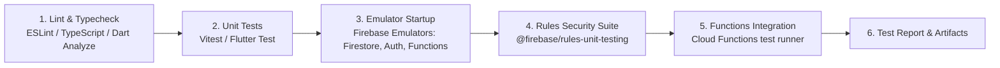

# Quality Assurance & Testing Strategy
## Badhon (NWU Blood Connect)
**Platform Name:** Badhon (বাঁধন) — NWU Blood Connect  
**Document Version:** 1.0.0  
**Phase:** Phase 1 — Requirements and Architecture  
**Date:** October 2026  

---

## 1. Testing Philosophy & Quality Pyramid

Badhon facilitates urgent community blood coordination where system bugs could delay medical transfusions or leak private contact data. Testing is built around a layered pyramid emphasizing **security rules verification** and **transactional integrity**:

```
          / \
         / E2E \         End-to-End (Emulator full-flow simulation)
        /-------\
       /  Integ  \       Integration (Cloud Functions + Firestore transactions)
      /-----------\
     /  Security   \     Rules Unit Tests (@firebase/rules-unit-testing)
    /---------------\
   /   Unit Tests    \   Validation, Enums, Normalization, Calculations
  /-------------------\
```

---

## 2. Layered Test Suites

### 2.1 Unit Testing
- **Scope:** Pure functions, domain types, regex normalization, date math.
- **Tools:** Vitest / Jest (TypeScript), `test` (Dart).
- **Core Test Cases:**
  1. `validateBangladeshiPhone`: Normalizes formats (`01712345678`, `+8801712345678`, `8801712345678`) to `+8801712345678`; rejects malformed inputs (`012...`, 12-digit numbers).
  2. `isDonorEligible`: Asserts 90-day cooldown boundary logic ($T_{\text{last}} + 90\text{ days}$).
  3. `isValidBloodGroup`: Asserts acceptance of the 8 canonical ABO/Rh strings and rejection of invalid values.
  4. `computeUrgencyDeadline`: Verifies that `EMERGENCY` requests receive max 6h expiry, `URGENT` receives 24h, and `NORMAL` receives 72h.

---

### 2.2 Security Rules Testing (`firestore.rules.test.ts`)
- **Scope:** Execution of security rules inside the local Firebase Firestore Emulator using `@firebase/rules-unit-testing`.
- **Mandatory Test Cases:**

| Test Case ID | Action Under Test | User Context | Expected Result |
| :--- | :--- | :--- | :--- |
| **SEC-001** | Direct read on `donorPrivate/victimUid` | Authenticated Attacker (`uid: "attacker"`) | **DENIED** |
| **SEC-002** | Direct write on `donorPublic/victimUid` | Authenticated Attacker | **DENIED** |
| **SEC-003** | Update `users/uid` to set `affiliationVerified: true` | Normal User (`uid: "user1"`) | **DENIED** |
| **SEC-004** | Direct read on `contactGrants/grantId` | Authenticated Requester | **DENIED** (Must use Cloud Function) |
| **SEC-005** | Write to `adminAuditLogs/logId` | Admin / Normal User | **DENIED** (Server-only) |
| **SEC-006** | Read `requestPublic/reqId` | Unauthenticated Guest | **ALLOWED** |
| **SEC-007** | Read `donorPublic/donorId` (`isPublicVisible: false`) | Unauthenticated Guest | **DENIED** |
| **SEC-008** | Read `donorPublic/donorId` (`isPublicVisible: true`) | Unauthenticated Guest | **ALLOWED** |
| **SEC-009** | Update another user's `deviceTokens` | Authenticated Attacker | **DENIED** |
| **SEC-010** | Perform admin read on `reports` | Normal User without Custom Claim | **DENIED** |

---

### 2.3 Integration Testing
- **Scope:** Cloud Functions lifecycle, transactional writes, idempotency, event triggers.
- **Tools:** Firebase Functions Test SDK + Local Emulator Suite.
- **Core Scenarios:**
  1. `createBloodRequest`: Verifies creation of master request, creation of sanitized public projection, and matching notification outbox queue.
  2. `respondToRequest` (Concurrency): Simulates two concurrent donors accepting a request with `donorsNeeded: 1`. Asserts that exactly one succeeds and the other receives `RESOURCE_EXHAUSTED`.
  3. `getAuthorizedContact`: Asserts successful return of donor phone to the valid requester, and immediate `PERMISSION_DENIED` if called by an unauthorized user or after request cancellation.
  4. `cleanupExpiredRequests`: Advances emulator clock past `expiresAt`, triggers the scheduled function, and asserts request is transitioned to `EXPIRED` with all grants revoked.

---

### 2.4 Client UI Testing
- **Flutter Mobile:**
  - Form validation widget tests (phone formatting, empty required fields).
  - 8-state widget tests (loading spinners, error banners, empty states).
  - Accessibility tests: verifies all interactive widgets satisfy $\ge 48\text{dp}$ touch target bounds.
- **Next.js Web & Admin:**
  - React Testing Library component tests.
  - Keyboard navigation and focus ring visibility on form controls.
  - Route guard checks: redirects non-admin users attempting to load `/admin/*`.

---

### 2.5 End-to-End Simulation (E2E)
- **Scope:** Complete user journey executed in local emulator environment.
- **Workflow:**
  1. Requester signs in with synthetic account `requester@test.nwu.edu.bd` and verifies phone `+8801700000001`.
  2. Requester creates an emergency request for `B_POSITIVE` blood at Khulna Medical College Hospital.
  3. Backend trigger queries eligible donors and logs notification to synthetic donor `donor@test.nwu.edu.bd` (`+8801700000002`).
  4. Donor opens notification and executes `respondToRequest(requestId, 'ACCEPT')`.
  5. Requester calls `getAuthorizedContact(requestId, donorUid)` and retrieves `+8801700000002`.
  6. Requester marks request `FULFILLED`.
  7. System marks request fulfilled and revokes the contact grant.
  8. Requester attempts to call `getAuthorizedContact` again $\rightarrow$ asserts `PERMISSION_DENIED`.

---

## 3. Synthetic Test Data Policy

> [!CAUTION]
> **Strict Prohibition on Real Personal Data:** Under no circumstances should real personal phone numbers, real student IDs, or real patient names be used in automated tests, seed scripts, or fixtures.

### Standard Synthetic Fixtures:
- **Phone Numbers:** Reserved test block `+8801700000001` through `+8801700000099`.
- **Emails:** `@test.nwu.edu.bd` (e.g., `donor1@test.nwu.edu.bd`, `admin@test.nwu.edu.bd`).
- **Student IDs:** `TEST-2026-001`, `TEST-2026-002`.
- **Hospitals:** Khulna Medical College Hospital (KMCH), Khulna City Medical College, Khulna Sadar Hospital.

---

## 4. Test Automation & CI/CD Pipeline

The continuous integration pipeline runs on every pull request and validates all code before merging:



### Command Execution Baseline:
- `npm run lint` — Monorepo static analysis.
- `npm run test:unit` — Domain and pure function unit tests.
- `npm run test:rules` — Firestore Security Rules unit test suite against emulator.
- `npm run test:functions` — Cloud Functions integration suite against emulator.
- `flutter test` — Mobile client unit and widget tests.
