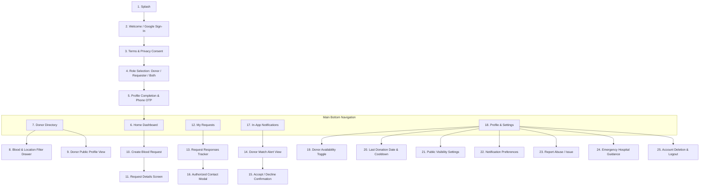

# UI Screen Map & Design System Specification
## Badhon (NWU Blood Connect)
**Platform Name:** Badhon (বাঁধন) — NWU Blood Connect  
**Design Philosophy:** Anti-AI-slop, Healthcare-grade Clarity, Tactile Trust, Mobile-First  
**Document Version:** 1.0.0  
**Phase:** Phase 1 — Requirements and Architecture  
**Date:** October 2026  

---

## 1. Visual Design System & Design Tokens

Badhon is designed to inspire calm, urgent utility and unimpeachable trust. It rejects decorative AI clichés (such as floating gradient blobs, fake browser chrome, and ungrounded marketing metrics) in favor of crisp typography, tactile surfaces, and restrained crimson highlights.

### 1.1 Color Palette & Tokens (WCAG 2.1 AA/AAA Compliant)
All interactive elements maintain a contrast ratio $\ge 4.5:1$ against their surfaces.

| Token Name | Hex Code | OKLCH Equivalent | Semantic Role |
| :--- | :--- | :--- | :--- |
| `--color-brand-primary` | `#DC2626` | `oklch(0.58 0.22 25.5)` | Brand crimson (blood accent, emergency CTA). |
| `--color-brand-hover` | `#B91C1C` | `oklch(0.51 0.20 25.5)` | Pressed / hover state for primary buttons. |
| `--color-surface-bg` | `#F8FAFC` | `oklch(0.98 0.01 240)` | Main application background (soft paper). |
| `--color-surface-card` | `#FFFFFF` | `oklch(1.00 0.00 0)` | High-contrast card surface. |
| `--color-text-primary` | `#0F172A` | `oklch(0.18 0.03 260)` | Primary headings and body copy (14:1 contrast). |
| `--color-text-secondary`| `#475569` | `oklch(0.45 0.03 255)` | Helper text and metadata (5.5:1 contrast). |
| `--color-border-subtle` | `#E2E8F0` | `oklch(0.91 0.01 250)` | Dividers and hairline borders (1px). |
| `--color-status-urgent` | `#EA580C` | `oklch(0.62 0.20 45)` | Urgent flag (6–24h deadline). |
| `--color-status-crit` | `#B91C1C` | `oklch(0.51 0.20 25.5)` | Emergency flag (<6h deadline). |
| `--color-status-avail` | `#16A34A` | `oklch(0.62 0.18 145)` | Available donor indicator / Success state. |
| `--color-status-wait` | `#64748B` | `oklch(0.55 0.02 255)` | In-cooldown / Unavailable indicator. |

### 1.2 Typography System
- **Font Stack:** Plus Jakarta Sans (headings, geometric clarity) & Inter (body, microcopy).
- **Rule:** Strict Roman typography (`font-style: normal`). **Italic headers are strictly forbidden.**
- **Base Size:** 16px body on mobile to prevent automatic iOS zoom.
- **Scale:**
  - `Display / H1`: 32px / line-height 1.2 (Bold 700)
  - `Title / H2`: 24px / line-height 1.3 (SemiBold 600)
  - `Subtitle / H3`: 18px / line-height 1.4 (Medium 500)
  - `Body / P`: 16px / line-height 1.5 (Regular 400)
  - `Caption / Badge`: 13px / line-height 1.4 (Medium 500)

### 1.3 Tactile Interaction & Spacing Standards
- **8dp Grid System:** Spacing scale strictly follows 4, 8, 12, 16, 24, 32, 48px increments.
- **Touch Target Floor:** All buttons, chips, and tappable rows maintain a minimum hit area of $48 \times 48\text{ dp}$ (Android) and $44 \times 44\text{ pt}$ (iOS/Web).
- **8-State Discipline:** All interactive primitives define visual styling across:
  `default` · `hover` · `focus-visible` · `active` · `disabled` · `loading` · `error` · `success`.

---

## 2. Mobile Application Screen Inventory (Flutter)

The mobile client encompasses 25 focused, accessible screens:

### Detailed Mobile Screen Specifications:

1. **Splash Screen (`/splash`):** Clean white screen with official Badhon emblem, university affiliation tagline, and auto-session check.
2. **Welcome & Login (`/auth/welcome`):** Mission value proposition, Google Sign-In primary button, guest mode link.
3. **Consent & Privacy Notice (`/auth/consent`):** Clear explanation of phone privacy, non-medical disclaimer, and donor consent terms.
4. **Role Selection (`/auth/roles`):** Three large tactile cards: "I want to donate blood", "I may need to request blood", "Both".
5. **Profile Completion (`/auth/profile-setup`):** Name, Blood group selector, NWU student/employee ID (optional), Department, Division/District/Upazila selector, Bangladeshi phone number OTP verification.
6. **Home Dashboard (`/home`):** Urgent campus emergency broadcast ticker, donor availability status banner, quick "Request Blood Now" red CTA, recent activity.
7. **Donor Directory (`/directory`):** Paginated search list with blood group pills, location filter chip bar, sanitized cards showing public availability.
8. **Directory Filter Drawer (`/directory/filters`):** Multi-select blood group grid, Khulna Upazila dropdown, affiliation toggle (`NWU Members Only`).
9. **Sanitized Donor Profile (`/donor/:id`):** Displays blood group, broad location, donation readiness badge, and disclaimer that direct calls require an emergency request response.
10. **Create Blood Request (`/request/new`):** Multi-step form: Blood group, donor count vs units, hospital name, Khulna district/thana, urgency selector, required date/time, brief note.
11. **Request Details (`/request/:id`):** Timeline of request, progress bar (e.g., 1 of 2 donors accepted), hospital address, map pin link, cancellation button.
12. **My Requests (`/my-requests`):** Segmented list of Active vs Past requests created by the user with real-time status chips.
13. **Requester Responses Tracker (`/request/:id/responses`):** Displays list of donors who accepted. Shows "View Contact" button when authorized.
14. **Donor Match Alert (`/notifications/match/:id`):** Full-screen priority alert showing hospital name, urgency level, and distance/area.
15. **Accept/Decline Modal (`/request/:id/respond`):** Confirmation dialogue showing explicit consent notice before sharing contact number.
16. **Authorized Contact Screen (`/request/:id/contact/:donorId`):** Verified donor name, phone number with one-tap Call button, and optional WhatsApp link button.
17. **In-App Notification Center (`/notifications`):** Unread/read status list with timestamps and direct deep-links.
18. **Edit Profile (`/profile/edit`):** Update personal details, contact address, and NWU department.
19. **Donor Availability Management (`/profile/availability`):** Large toggle switch: "Available for Emergency Calls".
20. **Last Donation Date & Cooldown (`/profile/cooldown`):** Calendar picker to log last donation, visual 90-day progress ring showing days remaining until next eligibility.
21. **Privacy Settings (`/profile/privacy`):** "Show my profile in public directory" toggle; explanation of contact protection.
22. **Notification Preferences (`/profile/notifications`):** Push alert toggles for emergency requests, sound settings, and urgent-only filter.
23. **Report Abuse / Fraud (`/report`):** Category picker (Spam, Broker, Harassment, Fake request), evidence note input, submit report.
24. **Emergency Guidance & Contacts (`/help`):** Local Khulna hospital emergency lines (KMCH, Khulna Sadar Hospital), blood preservation guidance, campus club contacts.
25. **Account Deletion & Logout (`/profile/security`):** Secure logout, account deletion workflow with 30-day grace explanation.

---

## 3. Public Web Portal Screen Inventory (Next.js)

1. **Landing Page (`/`):**
   - High-contrast hero section with emergency blood search.
   - Real-time sanitized ticker of active emergency needs in Khulna.
   - Explanation of the consent-based contact security model.
   - NWU Badhon campus statistics and upcoming voluntary blood donation camps.
2. **How It Works (`/how-it-works`):**
   - Interactive visual walkthrough for both Donors and Requesters.
3. **Public Sanitized Directory (`/donors`):**
   - Filterable donor list for community visibility (no phone numbers shown).
4. **Public Active Requests (`/requests`):**
   - Community board of urgent hospital needs with status indicators.
5. **Request Blood / Sign-In Gateway (`/request-blood`):**
   - Direct onboarding flow prompting Google Sign-In.
6. **About Badhon & NWU (`/about`):**
   - History of the campus initiative, leadership, and volunteer coordinators.
7. **Privacy Policy (`/privacy`):**
   - Complete legal and data-protection disclosure.
8. **Terms of Service & Disclaimer (`/terms`):**
   - Explicit disclaimer of medical liability and user code of conduct.
9. **Emergency Contacts & FAQ (`/help`):**
   - Khulna ambulance and transfusion center directory.
10. **Error & 404 Pages (`/not-found`, `/error`):**
    - High-utility fallback pages with links back to emergency search.

---

## 4. Admin Dashboard Screen Inventory (Next.js)

1. **Admin Login & Check (`/admin/login`):**
   - Google Sign-In with automated server-side custom claim verification. Access denied state for non-admins.
2. **Executive KPI Overview (`/admin`):**
   - Metrics: Total Users, Registered Donors, Active Requests, Pending Reports, Notification Health.
3. **User Management (`/admin/users`):**
   - Searchable, paginated user table with affiliation filters, account status, and suspend/reactivate actions.
4. **Donor Management (`/admin/donors`):**
   - Directory metrics, blood group distribution charts, and verification badge grants.
5. **Blood Request Moderation (`/admin/requests`):**
   - Live inspection table of all requests with status filters, force-cancel controls, and reason logs.
6. **Request Details & Event Timeline (`/admin/requests/:id`):**
   - Complete audit trail of request creation, notifications sent, donor responses, and contact fetches.
7. **Abuse Reports Queue (`/admin/reports`):**
   - Triage table for user reports; status transitions (`INVESTIGATING`, `RESOLVED`, `DISMISSED`) with admin notes.
8. **Notification System Health (`/admin/notifications`):**
   - Outbox processing health, FCM delivery success rates, failure retry counts, and dead-letter queue.
9. **Audit Log Explorer (`/admin/audit`):**
   - Immutable log viewer for Super Admins showing every privileged action, timestamp, and admin UID.
10. **System Configuration & Roles (`/admin/settings`):**
    - Dynamic adjustment of expiry hours, cooldown days, maintenance mode, and Super Admin role delegation.

---

## 5. Responsive Breakpoint Standards

- **Small Phone (`320px - 375px`):** Single column layouts, sticky bottom action bar, condensed header.
- **Standard Phone (`376px - 414px`):** Standard mobile view, $16\text{px}$ page gutters, $48\text{dp}$ touch elements.
- **Tablet (`768px - 1024px`):** Two-column card grids, persistent sidebar navigation for admin.
- **Desktop (`1024px+`):** Admin data tables with horizontal scroll containment, max-width $1200\text{px}$ container for public web.
